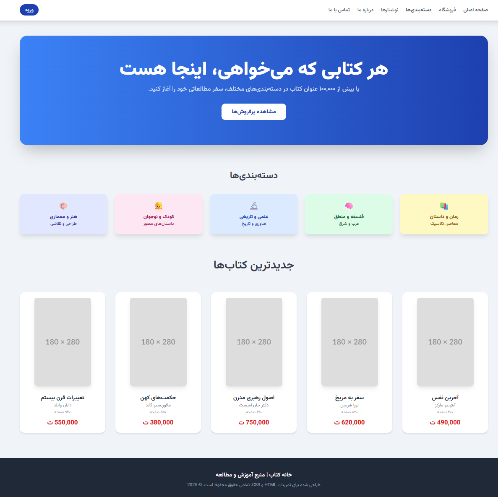
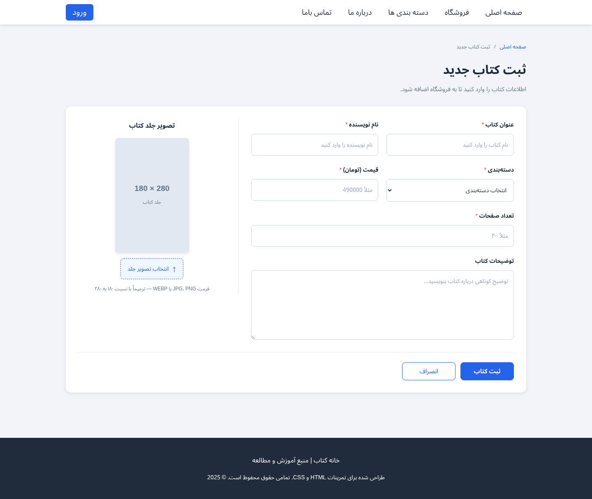

# Library Management MVC | خانه کتاب

A Persian RTL web library application built with **ASP.NET Core MVC (.NET 10)**, **Entity Framework Core 10**, **SQL Server**, C#, Repository Pattern, Service Layer, and Fluent API.

The UI is based on the author's Week 17 ASP.NET Core MVC bookstore design, preserving the original IRANSans font, blue/gray palette, rem-based spacing, BEM naming and Flexbox layout.

> **Educational demo:** This is a sample project for local learning and portfolio review, **not production-ready authentication or a hosted bookstore**. Custom Session sign-in is intentionally used instead of ASP.NET Identity/authorization libraries. Sample passwords are weak by request; change them if this project leaves your local computer.





[Open the static home UI preview locally](docs/home-static-preview.html) (layout demo only; not a live database connection).

## Features

- Home page: categories and **the latest 5 books from SQL Server**, not hard-coded view data
- All books, search, category filter, availability filter, book details
- Book create/edit/delete with optional image upload (`wwwroot/images/books`)
- Category create/edit/delete, image upload and browse
- Demo register/login/logout and user profile (Session)
- Change username and password
- Wishlist: add, list and remove per user
- One physical copy per book: cannot borrow an already active loan
- Return books; 7-day due date, **10,000 toman per late day**, user penalty balance
- Rate books (1–5) and comment, edit/delete own review; Admin approve/reject workflow
- Admin dashboard: users, active loans, pending reviews, add/edit books and categories
- Responsive tablet/mobile UI with hover, focus and helpful empty states

## Structure

```text
Library.slnx
01.Domain/Library.Domain/
  Entities/               Book, Category, User, BookLoan, Review, Wishlist
  Contracts/Repositories/  IBookRepository, ILoanRepository, etc.
  Contracts/Services/      IBookService, ILoanService, etc.
  DTOs/                   BookDto, LoanDto, UserDto, ...
  Results/                ResultDto<T>
  Exceptions/             DomainException and business rule exceptions
02.Application/Library.Application/
  Services/               AuthService, BookService, CategoryService,
                          UserService, LoanService, ReviewService, WishlistService
  Security/               PasswordSecurity (PBKDF2)
03.Infrastructure/Library.Infrastructure/
  Data/                   LibraryDbContext, design-time factory, UnitOfWork
  Repositories/           6 separate repository classes
  Configurations/         6 separate Fluent API configurations + SeedData
04.Web/Library.Web/
  AppServices.cs          Manual object composition (no app-level DI registration)
  Controllers/            MVC Controllers, each action uses a service
  Models/                 Input and page ViewModels
  Views/                  Razor views and reusable _BookCard partial
  wwwroot/css/            Original site-responsive.css, create-book.css, app.css
  wwwroot/images/         Seed book/category artwork
```

### Requirements

- **Windows**, .NET **10 SDK**, Visual Studio 2022 with .NET 10 tooling or Visual Studio 2026
- SQL Server LocalDB or SQL Server Express/Developer
- **SSMS** for database inspection
- Internet connection for the initial NuGet restore (unless already cached)

### Run locally (Visual Studio + Package Manager Console)

1. Unzip, open `Library.slnx` in Visual Studio.
2. Right-click **Library.Web** and choose **Set as Startup Project**.
3. Confirm the connection string in `04.Web/Library.Web/appsettings.json`:

```json
"ConnectionStrings": {
  "DefaultConnection": "Server=(localdb)\\MSSQLLocalDB;Database=LibraryWebDemo;Trusted_Connection=True;TrustServerCertificate=True"
}
```

If using the standard SQL Server service rather than LocalDB, change `Server=` to `.` or `localhost` according to your instance. The `LibraryDbContextFactory` reads the same `appsettings.json` at migration time; environment variable `LIBRARY_CONNECTION_STRING` overrides the design-time connection when set.

4. Restore NuGet packages (Visual Studio usually does this automatically). NuGet references are already included in the `.csproj` files: `Microsoft.EntityFrameworkCore.SqlServer`, `Microsoft.EntityFrameworkCore.Design`, and `Microsoft.EntityFrameworkCore.Tools`, all at **10.0.15**.
5. Open **Tools → NuGet Package Manager → Package Manager Console** and execute:

```powershell
Add-Migration InitialCreate -Project Library.Infrastructure -StartupProject Library.Web -Context LibraryDbContext
Update-Database -Project Library.Infrastructure -StartupProject Library.Web -Context LibraryDbContext
```

6. Press **F5** or **Ctrl+F5** in Visual Studio. Home is the default route.
7. Open SSMS, connect using **Windows Authentication** to `(localdb)\MSSQLLocalDB`, then browse **Databases → LibraryWebDemo → Tables**.

`HasData` produces SQL INSERTs as part of the initial migration. After `Update-Database`, the DB starts with **5 categories, 20 books and 4 users**. Migrations are **not pre-generated**: the first command above creates them from the EF model as requested.

### dotnet CLI alternative

From the folder containing `Library.slnx`:

```powershell
dotnet restore
dotnet ef migrations add InitialCreate --project 03.Infrastructure/Library.Infrastructure --startup-project 04.Web/Library.Web --context LibraryDbContext
dotnet ef database update --project 03.Infrastructure/Library.Infrastructure --startup-project 04.Web/Library.Web --context LibraryDbContext
dotnet run --project 04.Web/Library.Web
```

For the CLI, `dotnet-ef` must be installed if not already available (`dotnet tool install --global dotnet-ef --version 10.0.15`). The Visual Studio PMC commands do not require that global CLI tool.

### Demo accounts

| Role | Username | Password |
| --- | --- | --- |
| Admin | `admin` | `123456` |
| Member | `amir` | `123456` |
| Member | `sara` | `123456` |
| Member | `ali` | `123456` |

Passwords are hashed using PBKDF2 + individual salts, and not stored in plaintext. All demo passwords are intentionally simple for a **local-only learning demo**.

### How to try features

1. Log in as `admin`; open **مدیریت** → **ثبت کتاب جدید**; upload a cover and save.
2. Visit home. The new book appears automatically in **جدیدترین کتاب‌ها**.
3. Log in as `amir`; borrow a book from its details page, then try to borrow the same book as `sara` — you should see it is unavailable.
4. Return the book from **حساب من → امانت‌های من**. Late returns accrue 10,000 toman per day after the seventh day.
5. Save a favorite, add a star review, then sign in as `admin` to approve it.

### Code design notes

- Domain entities own business rules; relationships are passed as entity objects (e.g., `new BookLoan(user, book, today)`).
- Each entity has its own repository and `IEntityTypeConfiguration` class.
- Contracts for both repositories and services live in Domain.
- Every application Service API returns a generic `ResultDto<T>`.
- Services depend on repository interfaces and `IUnitOfWork`, not on EF types.
- The MVC layer manually assembles the dependencies in one `AppServices` factory. ASP.NET Core itself uses its own services internally for controllers and Session, but there is **no user-defined `AddScoped`/`AddTransient`/constructor injection**.
- No `async` / `await` methods, no ASP.NET Core Identity or authorization framework, no GUID identifiers, no external frontend framework, no automated test suite.
- Sensitive mutation actions check logged-in user/admin server-side, and POST forms are anti-forgery protected.

### Known limitations

- The project was prepared without a .NET 10 SDK/SQL Server runtime in the authoring environment. **Compilation, migrations and end-to-end behavior have not been executed or verified** here; run the commands above to validate locally before listing it in a resume.
- Session login is simple and intended for demonstration; do not expose the default credentials on a public production deployment.
- Each book is treated as **one physical copy**. A future enhancement could support inventory quantities and transaction retries for concurrent borrowing.
- Existing entity artwork includes five original custom covers and simple SVG covers for other seeded books.
- Hosting a live ASP.NET Core website requires a compatible host; **GitHub repository pages alone cannot run server-side MVC code**. The screenshot above is the author's original UI reference, not a verified live screenshot.

## GitHub portfolio note

A reviewer can browse the source, the original UI reference, the feature list and the local setup guide directly on GitHub. To offer an interactive public demo later, deploy the app + SQL Server to a suitable host and put its URL here.

---
Based on the author's previous [console Library Management project](https://github.com/amir-fayazi/week12-library-management). Original project and design files remain under their own repositories; this is an independent MVC version.
